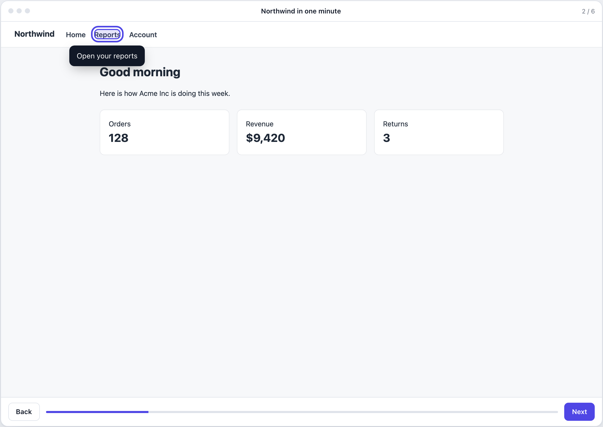

<p align="center">
  <picture>
    <source media="(prefers-color-scheme: dark)" srcset="assets/logo-dark.svg">
    
  </picture>
</p>

<p align="center"><strong>Interactive product demos, built from a script and rebuilt when your product changes.</strong></p>

<p align="center">
  <a href="https://github.com/umar418/demokiln/actions/workflows/ci.yml"></a>
  
  
  
</p>

Demokiln is a free, open-source alternative to paid interactive demo tools such as Arcade, Storylane, Supademo and Navattic. You describe the steps once. Demokiln walks through your real app in a browser, captures each screen, and writes **one self-contained HTML file** with clickable hotspots and captions that visitors drive themselves.

<p align="center"></p>

**Status: early (version 0.0.1), not yet on npm.** What works is listed under [Features](#features); what does not is under [Limits](#limits) and [Roadmap](#roadmap).

## Contents

- [Why Demokiln](#why-demokiln)
- [How it works](#how-it-works)
- [Install](#install)
- [Quick start](#quick-start)
- [Features](#features)
- [Writing a demo](#writing-a-demo)
- [Settings](#settings)
- [Commands](#commands)
- [Keeping demos up to date](#keeping-demos-up-to-date)
- [Putting a demo on your site](#putting-a-demo-on-your-site)
- [Privacy](#privacy)
- [Security](#security)
- [Limits](#limits)
- [How it compares](#how-it-compares)
- [FAQ](#faq)
- [How it was tested](#how-it-was-tested)
- [Roadmap](#roadmap)
- [Contributing](#contributing)
- [License](#license)

## Why Demokiln

Interactive demos let a visitor click through your product without signing up. The tools that make them share one weakness: a demo is recorded by hand, so it is out of date the moment your product's screens change, and someone has to record it again.

Demokiln treats a demo as a build output instead of a recording:

- **Written once, rebuilt any time.** The steps live in a small file next to your code. Run the build again after a release and the demo shows the new screens.
- **It tells you when a demo is stale.** `demokiln check` re-runs the steps and reports a renamed button or a changed screen before your visitors see it.
- **One file, no service.** The demo is a single HTML file. Host it anywhere, attach it to an email, or open it from disk. There is no account, no per-seat price and nothing to keep running.
- **Private by construction.** It runs on your machine, uses no AI model, and the finished demo loads nothing from the network.

## How it works

1. **You write the steps**, in TypeScript or a plain YAML file, or record them by clicking through your app.
2. **Demokiln opens your app** in a real browser (Chromium, through Playwright) and performs each step.
3. **Before each action it captures the screen**, once the app has finished loading, and notes where the element to click is.
4. **Each screen is kept as the page's real structure**, so it stays sharp at any size. The copy is compared pixel by pixel with a screenshot taken at the same moment. If they differ, the screenshot is used instead and the build says so.
5. **It writes `demo.html`**: the screens, the player, and nothing else.

## Install

Demokiln needs **Node 20 or newer** and **Playwright with Chromium**. It runs on Linux, macOS and Windows.

It is not on npm yet. Install it from GitHub:

```bash
npm install --save-dev github:umar418/demokiln playwright
```

```bash
npx playwright install chromium
```

Check that everything is ready:

```bash
npx demokiln doctor
```

## Quick start

Create a starter steps file:

```bash
npx demokiln init demo.yaml
```

Edit it so it points at your app:

```yaml
url: http://localhost:3000
title: A quick tour
steps:
  - note: Welcome. This tour takes about a minute.
  - click: Reports
    caption: Open your reports
  - fill: From
    value: "2026-01-01"
    caption: Pick a start date
  - click: Apply
    caption: Apply the filter
  - note: Your orders appear here.
    at: "#result"
```

Build the demo:

```bash
npx demokiln build demo.yaml
```

Open it:

```bash
npx demokiln preview demo.html
```

That is the whole loop. `demo.html` is ready to host.

Prefer to click instead of type? Record the steps:

```bash
npx demokiln record http://localhost:3000
```

A browser opens. Click through your app, close the window, and Demokiln writes `demo.yaml` for you to reword.

## Features

- **Steps:** click, double-click, fill, select, press a key, hover, note, hidden setup steps (for signing in), chapters and waits.
- **Real pages, not just pictures.** Screens are kept as the page's real structure, so text stays sharp at any size and files stay small. The six-screen sample is about 30 KB when every screen is kept this way.
- **Checked against reality.** Every copy is compared with a real screenshot. If they differ by more than a few pixels, the screenshot is used and the build says which screen and why.
- **The same for every viewer.** Conditions that depend on the viewer (screen density, touch, contrast, colour scheme, scrollbars) are decided at capture time and fixed in the copy.
- **Captures wait for the app.** A screen is captured once requests, short timers and animation frames have finished and two captures in a row are identical. If that does not happen in time, the build warns.
- **Broken steps stop the build** and name the step. So does a target hidden under a banner or a fixed header.
- **Finding things by text.** Only visible elements count. If the text matches more than one distinct element, the step fails rather than guessing.
- **Stale-demo check** with a before-and-after page.
- **Repeatable builds.** The app's clock starts at a set time and it gets a fixed random sequence.
- **Recorder** that writes a steps file from your clicks.
- **Other outputs:** a step-by-step Markdown guide, one image per screen with the click target outlined, and a JSON description.
- **Player:** hotspots, captions, chapters, progress, keyboard control, autoplay, a closing screen with a call-to-action button, light and dark mode, and zoom on small screens.
- **Accessible:** the whole demo works from the keyboard, captions are exposed to screen readers, and reduced-motion settings are respected.

## Writing a demo

### As a steps file (YAML)

No code needed. Elements are found by what a person sees: a button or link name, a field label, a placeholder, or exact text.

| Step | Example | What it does |
|---|---|---|
| `click` | `click: Reports` | Shows a hotspot on the element, then clicks it |
| `dblclick` | `dblclick: Chart` | Shows a hotspot, then double-clicks |
| `fill` | `fill: Email` with `value: "a@example.com"` | Shows a hotspot on the field, then types the value |
| `select` | `select: Plan` with `option: Team` | Shows a hotspot on the list, then chooses an option |
| `press` | `press: Enter` with `on: Search` | Shows a hotspot, then presses a key there |
| `hover` | `hover: Account` | Shows a hotspot, then moves the pointer over it |
| `note` | `note: Your orders appear here.` | Shows a caption only. Add `at:` to point at an element |
| `chapter` | `chapter: Reports` | Names the section the following steps belong to |
| `hidden` | `hidden:` followed by a list of steps | Runs steps that must not appear, such as signing in |
| `wait` | `wait: 500` | Pauses for a number of milliseconds |

Every step that shows a screen needs a `caption` (for `note`, the text itself is the caption). Captions are limited to 280 characters.

**Pointing at elements.** Plain text means "what is on screen". A value starting with `#`, `.` or `[`, or prefixed with `css=`, is a CSS selector:

```yaml
- click: Save            # the visible button, link, tab or text "Save"
- click: "#save-button"  # a CSS selector
- click: css=nav a.primary
```

**Values and secrets.** Put `fill` values in quotes so they are typed exactly as written. Use `${NAME}` to read an environment variable, and `$$` for a literal dollar sign:

```yaml
- hidden:
    - fill: Email
      value: "${DEMO_EMAIL}"
    - fill: Password
      value: "${DEMO_PASSWORD}"
    - click: Sign in
```

A mistake in the file is always an error that says what is wrong. Unknown settings are never silently ignored.

### As a script (TypeScript)

Use a script when you want the full power of Playwright: conditions, loops, waiting for a specific thing.

```ts
import { demo } from "demokiln";

export default demo(
  {
    url: "http://localhost:3000",
    title: "A quick tour",
    mask: [".customer-email"],
    replace: { "Real Customer Ltd": "Acme Inc" },
    cta: { label: "Start free", url: "https://example.com/signup" },
  },
  async ({ page, step }) => {
    // Setup that should not appear in the demo:
    await step.hidden(async () => {
      await page.getByLabel("Email").fill(process.env.DEMO_EMAIL ?? "");
      await page.getByRole("button", { name: "Sign in" }).click();
    });

    await step.note("Welcome. This tour takes about a minute.");
    step.chapter("Reports");
    await step.click(page.getByRole("link", { name: "Reports" }), "Open your reports");
    await step.fill(page.getByLabel("From"), "2026-01-01", "Pick a start date");
    await step.select(page.getByLabel("Plan"), "Team", "Choose a plan");
    await step.press(page.getByLabel("Search"), "Enter", "Search");
    await step.note("Your orders appear here.", { at: "#result" });
  },
);
```

A target can be a Playwright locator, a CSS selector string, or `{ text: "Reports" }` to find it by what is on screen.

| Method | Purpose |
|---|---|
| `step.click(target, caption)` | Capture, then click |
| `step.dblclick(target, caption)` | Capture, then double-click |
| `step.fill(target, value, caption)` | Capture, then type |
| `step.select(target, option, caption)` | Capture, then choose an option by its label or value |
| `step.press(target, key, caption)` | Capture, then press a key |
| `step.hover(target, caption)` | Capture, then hover |
| `step.note(caption, { at })` | Capture with a caption only |
| `step.hidden(async () => { ... })` | Run setup without capturing |
| `step.chapter(title)` | Start a chapter |

### By recording

```bash
npx demokiln record http://localhost:3000 -o demo.yaml
```

The recorder writes clicks, typed text, list choices, Enter in a field, and double-clicks. It uses the visible name of what you clicked when that name is unique on the page, and a CSS selector otherwise. A field that is, or ever was, a password field is written as `${DEMO_PASSWORD}`, never as the text you typed.

## Settings

These go at the top of a steps file, or in the first argument to `demo()`.

| Setting | Default | Meaning |
|---|---|---|
| `url` | required | Where the demo starts (`http`, `https` or `file`) |
| `title` | `Product demo` | Shown in the player's title bar |
| `viewport` | `desktop` | `desktop` (1280×800), `tablet` (834×1112), `phone` (390×844), or `{ width, height }` |
| `scale` | `2` | Pixel density of captures, 1 to 3. Lower means smaller files |
| `colorScheme` | `light` | `light` or `dark`: which version of your app to capture |
| `mask` | none | List of CSS selectors to cover in every screen |
| `replace` | none | Pairs of text to swap, such as a real customer name for a sample one |
| `capture` | `auto` | `auto` keeps real pages when they match; `screenshot` always uses screenshots |
| `fidelity` | `0.002` | Share of pixels a copy may differ from the screenshot, 0 to 0.05 |
| `time` | build time | Date and time the app's clock starts at, such as `"2026-01-15T09:30:00Z"` |
| `stepTimeout` | `10000` | Milliseconds to wait for a step's element or action |
| `settleTimeout` | `8000` | Milliseconds to wait for the app to finish before a capture |
| `storageState` | none | Path to a saved Playwright session, for apps behind sign-in |
| `endCaption` | `That's the tour.` | Text on the closing screen |
| `cta` | none | `{ label, url }`: a button on the closing screen (`http` or `https` only) |
| `accent` | `#4f46e5` | Accent colour as a six-digit hex value |
| `autoplay` | off | Milliseconds per screen, 800 to 60000. The viewer can still take over |
| `allowSecrets` | none | Credential pattern ids to ignore when they are known false positives |

## Commands

| Command | What it does |
|---|---|
| `demokiln init [file]` | Create a starter demo. Name it `.yaml` for a steps file, `.ts` for a script |
| `demokiln record <url>` | Record steps by clicking through your app. `-o` sets the output file |
| `demokiln build [script]` | Run the steps and write the demo. `-o` sets the output file, `--headed` shows the browser, `--no-baseline` skips recording screens for `check` |
| `demokiln check [script]` | Re-run the steps and report whether the demo is out of date. `--baseline`, `--report`, `--no-visual`, `--headed` |
| `demokiln export [script]` | Write `guide.md`, `demo.json` and one image per screen. `-o` sets the folder |
| `demokiln preview [file]` | Serve a built demo on this machine only. `-p` sets the port |
| `demokiln doctor` | Check that the browser needed for capture is installed |

Defaults: the script is `demo.ts`, the output is `demo.html`, the baseline folder is `demo.baseline`.

**Exit codes:** `0` success, `1` a step failed or something is wrong, `2` `check` found the demo out of date.

## Keeping demos up to date

`build` records a baseline next to the demo: a screenshot of every screen, where each hotspot was, the captions, and the settings.

```bash
npx demokiln check demo.yaml
```

- **Exit 0:** every step works and nothing has changed.
- **Exit 1:** a step no longer works, for example a button was renamed. The message names the step.
- **Exit 2:** something differs from the last build: a screen looks different, a caption or chapter changed, a hotspot points somewhere else, or a setting changed. Demokiln writes `demo.check.html`, a page showing each changed screen before and after.

Rebuild to bring the demo up to date:

```bash
npx demokiln build demo.yaml
```

### In CI

Fail a pull request when a change breaks a demo's steps:

```yaml
- uses: actions/checkout@v4
- uses: actions/setup-node@v4
  with:
    node-version: 22
- run: npm ci
- run: npx playwright install --with-deps chromium
- run: npm run start &        # start your app however you normally do
- run: npx demokiln check demo.yaml --no-visual
```

`--no-visual` checks that every step still works without comparing screens. Comparing screens in CI needs a baseline built on the same operating system as the CI machine; see [Limits](#limits).

## Putting a demo on your site

`build` prints an iframe snippet sized to the demo:

```html
<iframe src="demo.html" title="A quick tour" loading="lazy"
        style="width:100%;aspect-ratio:1280 / 932;border:0"></iframe>
```

**Autoplay from the address.** Add `#autoplay=3000` to the address to advance every three seconds until the viewer does anything.

**Measuring use.** The player reports what happens to the page that embeds it. Nothing is sent anywhere by Demokiln itself; you forward the events to your own analytics.

```html
<script>
  window.addEventListener("message", (event) => {
    if (event.data?.source !== "demokiln") return;
    // event.data.type is "start", "step", "finish", "restart" or "cta"
    // event.data.step and event.data.total say how far the viewer is
    console.log(event.data.type, event.data.step, event.data.total);
  });
</script>
```

**Keyboard.** Right arrow, Enter or Space: next. Left arrow: back. Home: first screen.

## Privacy

A demo is a public copy of your screens, so Demokiln is careful about what gets in.

- **Password fields are always covered,** along with fields a browser marks as card or one-time-code fields, fields named like card numbers or security codes, and any field holding a valid card number.
- **`mask`** covers anything else you name. In a kept page the masked element's text and attributes are removed from the copy, not just hidden.
- **`replace`** swaps real text for sample text on screen and in attributes the screen does not show (`alt`, `title`, labels, `data-` values).
- **The build stops if a likely credential is on screen.** It recognises common key and token formats (cloud providers, source hosts, payment and messaging services, private keys, signed tokens). The error names the kind of credential and the step, never the value.
- **A page's source is checked too.** If a credential sits in the page but not on screen, that screen is captured as a screenshot so the source is never shipped.
- **Everything happens on your machine.** Nothing is uploaded, and no AI model is used.

## Security

The app being captured is treated as untrusted, as are steps files and recorded pages.

- **Nothing from a captured page can run in a demo.** Copies are parsed and cleaned outside the page that produced them: scripts, event handlers, frames, embeds and anything that could load a file are removed. The copy is then shown in a frame that is not allowed to run code, under a policy that permits only the player's own script.
- **A finished demo makes no network requests.** Images, fonts and styles are embedded; everything else is dropped.
- **The build makes no requests of its own.** It embeds only files the browser already loaded while showing your app, so a hostile page cannot use the build to reach other machines.
- **Captions and titles are plain text** in the demo, the check report, the exported guide and the terminal.
- **Files stay where they belong.** `preview` binds to this machine only, serves only the demo file, and does not follow links out of its folder. `check` refuses a baseline whose images are links.

To report a security problem, see [SECURITY.md](SECURITY.md).

## Limits

- **Values made by your server** (a timestamp or random number in the HTML it sends) cannot be fixed by Demokiln. `check` notices when a screen changes by itself and tells you to `mask` that part.
- **The app's clock runs.** It starts at a set time, so dates and times to the minute repeat between builds, but a time shown to the second will differ. Mask it.
- **A value typed by a `fill` step appears on the next screen,** so it is part of the demo. Use environment variables and hidden steps for anything private.
- **Screenshots instead of real pages.** Pages with web components that hide their internals, video, or embedded frames are captured as screenshots, which are larger and less sharp when zoomed. A screen can also fall back when a font or image could not be embedded.
- **The credential and card checks read text and field values.** They cannot read text inside images.
- **`replace` works on whole pieces of text.** If the text is split across elements, the build stops and asks you to use `mask`.
- **`check` compares screenshots,** so the baseline must come from the same operating system that runs the check. Fonts render differently between macOS, Linux and Windows. Use `--no-visual` to check only that the steps work.
- **Fonts.** Viewers see captured pages in their own fonts if your app relies on fonts installed on your machine rather than web fonts. Hotspots still land on the right element because they are measured live.
- **Windows high-contrast mode.** A viewer using it sees system colour names (such as `Canvas`) in their own palette.
- **The recorder is for your own app.** A page you record can read what you type into it. The recorder does not record hovering, so menus that open on hover need a `hover` step added by hand. Its path with a person clicking in a visible browser has had less testing than the rest.
- **Very narrow players.** On a phone-sized player a long caption can overlap what it points at.

## How it compares

| | Paid demo tools | Demokiln |
|---|---|---|
| Price | Per seat or per month | Free, MIT licensed |
| How a demo is made | Recorded by hand in a browser extension | Built from a steps file or script; can also be recorded |
| When the product changes | Record again | Run the build again |
| Knowing a demo is stale | You notice, or a visitor does | `demokiln check`, in CI if you like |
| Where it lives | The vendor's service | One HTML file you host anywhere |
| Your screens | Uploaded to the vendor | Never leave your machine until you publish the file |
| Hosted analytics, team workspaces, lead forms | Yes | No. Events are reported to your own page |
| Visual editor | Yes | Not yet |

Demokiln is a good fit if you are comfortable with a config file or a short script and want demos that stay current. If you want a hosted dashboard, built-in lead capture or a drag-and-drop editor today, a paid tool does more.

## FAQ

**Does it work with my framework?**
It works with anything that runs in a browser. Demokiln drives the page from outside, so it does not matter how the app is built.

**Can it capture an app behind sign-in?**
Yes. Sign in inside a `hidden` block with details from environment variables, or point `storageState` at a saved Playwright session.

**How big is a demo?**
It depends on how many screens are kept as real pages. The six-screen sample is about 30 KB with every screen kept and about 90 KB with one screenshot. An eleven-screen tour of a marketing site with five screenshots came to about 3 MB at the default `scale: 2`. Use `scale: 1` to roughly quarter the size of screenshots.

**Does a visitor need anything installed?**
No. A demo is an ordinary web page that needs JavaScript and nothing else.

**Can I edit a demo after building it?**
Edit the steps file and build again. There is no visual editor yet.

**Does it use AI or send my screens anywhere?**
No. It uses no AI model and makes no network requests beyond loading your own app in the browser it controls.

**Why did a screen come out as a screenshot?**
The copy of the page did not match the real screen exactly, and Demokiln will not show a copy that differs. The build output says which screen and why. Common causes are a web component with hidden internals, an embedded frame or video, or a font that could not be embedded.

**Why does `check` say a screen is different when I changed nothing?**
Part of that screen changes by itself, usually a time or a value your server generates. `check` says so when it detects this. Cover that part with `mask`.

**Can I use it for a command-line tool?**
No. Demokiln captures web pages. For terminal recordings, look at tools made for that.

## How it was tested

Two independent testers attacked the tool with about 145 cases: one for security and privacy, one for wrong or misleading output. They reproduced 40 defects, among them a build that could be made to contact other machines, credentials that slipped past the scan, screens captured before the app had finished loading, and a stale-demo check that missed small changes. All were fixed except the items listed under [Limits](#limits), and each fix has a regression test. Neither tester found a way to run code in, or get a network request out of, a finished demo.

The test suite runs on Linux, macOS and Windows with Node 20 and 22 on every push. CI also installs the packaged tool into an empty folder and runs it, which is how a missing run-time dependency was caught before release.

## Roadmap

Planned, and not built yet:

- Branching ("choose what to see next")
- Captures at phone and tablet sizes in the same demo
- A ready-made GitHub Action
- A visual editor for captions and hotspots
- GIF and MP4 export
- Integrations for AI coding agents
- A release on npm

## Contributing

Bug reports are welcome, especially a demo that shows something different from the real screen: include the page (if public), the step, and what differed.

```bash
git clone https://github.com/umar418/demokiln
```

```bash
npm install
```

```bash
npx playwright install chromium
```

```bash
npm test
```

## License

MIT
